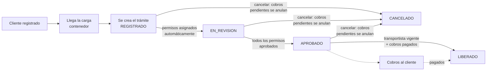
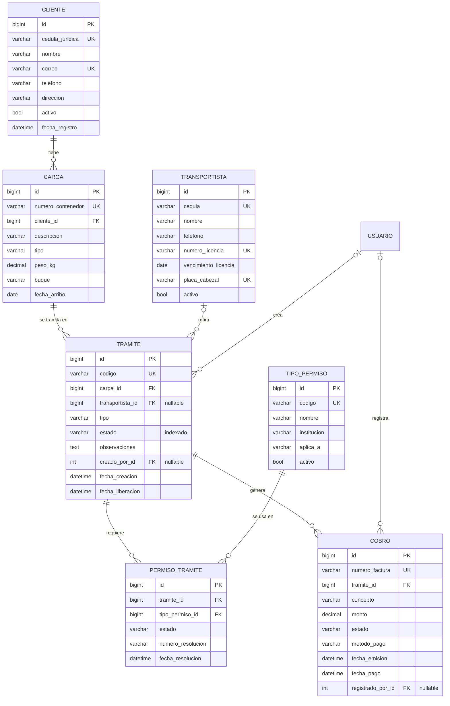

# Documento técnico — API de Trámites Aduanales

Desarrollo de Software IV · UCR Sede del Pacífico · Entrega: 29/10/2026  
Equipo: José David Jiménez Araya (C5G177) · Yerlin Oviedo Castro (C5I097)

---

## 1. Contexto y necesidad

Una agencia aduanal en Puerto Caldera atiende a empresas que importan y exportan contenedores. Para que un contenedor salga del puerto deben cumplirse varias condiciones: los permisos de las instituciones (Aduanas, Servicio Fitosanitario, Ministerio de Salud, MINAE), el pago de los servicios y un transportista habilitado que retire la carga.

Cuando esto se controla a mano aparecen errores: contenedores liberados con deudas, choferes con licencia vencida o permisos olvidados. Este backend **centraliza el proceso y bloquea automáticamente las operaciones que no cumplen las reglas**.

**Usuarios**

| Perfil | Quién es | Qué hace |
|---|---|---|
| Administrador | Jefatura de la agencia | Todo, incluido eliminar, anular cobros, catálogo y usuarios |
| Operador | Tramitador aduanero | Registra y actualiza clientes, cargas, trámites y cobros |
| Consulta | Contabilidad, servicio al cliente | Solo consulta datos y reportes |

## 2. Proceso de negocio



**Cómo circulan los datos entre módulos**

1. **Clientes** → se registra la empresa.
2. **Cargas** → cada contenedor pertenece a un cliente (FK). Si el cliente está inactivo, no se puede registrar la carga.
3. **Trámites** → toma una carga. Al crearse, consulta el **catálogo de permisos** y crea un registro de permiso por cada uno que exija el tipo de carga (N:M).
4. **Transportistas** → se asignan al trámite; el sistema revisa la licencia.
5. **Cobros** → se registran sobre el trámite. Al liberar, el trámite revisa que todos estén pagados.
6. **Reportes** → cruzan todos los módulos (por ejemplo, saldo pendiente por cliente pasando por cargas, trámites y cobros).

## 3. Módulos: entradas, salidas y relaciones

| Módulo | Entradas principales | Salidas | Relaciones |
|---|---|---|---|
| **Clientes** | cédula jurídica, nombre, correo, teléfono | cliente + cantidad de cargas | 1:N con Cargas |
| **Transportistas** | cédula, nombre, licencia y vencimiento, placa | transportista + `licencia_vigente` calculada | 1:N con Trámites |
| **Cargas** | contenedor, cliente, tipo, peso, buque, fecha de arribo | carga + nombre del cliente | N:1 con Cliente, 1:N con Trámites |
| **Trámites** | carga, tipo, transportista, observaciones; acciones de estado y permisos | trámite con código, permisos y resumen de cobros | N:1 con Carga y Transportista, N:M con TipoPermiso, 1:N con Cobros |
| **Cobros** | trámite, concepto, monto; acciones pagar y anular | cobro con número de factura y estado | N:1 con Trámite |

## 4. Diagrama entidad-relación



**Relaciones exigidas por RF-03**

- **1:N**: Cliente → Carga, Carga → Trámite, Transportista → Trámite, Trámite → Cobro.
- **N:M**: Trámite ↔ TipoPermiso mediante la tabla intermedia `PermisoTramite`, que guarda datos propios (estado, número de resolución y fecha).

## 5. Restricciones y políticas de borrado

| Restricción | Dónde | Motivo |
|---|---|---|
| `UNIQUE` cédula jurídica y correo | Cliente | Un cliente no se registra dos veces |
| `UNIQUE` cédula, licencia y placa | Transportista | Identifican a un solo chofer y cabezal |
| `UNIQUE` número de contenedor | Carga | El contenedor es único a nivel mundial (ISO 6346) |
| `UNIQUE` código | Trámite, TipoPermiso | Identificadores legibles |
| `UNIQUE` número de factura | Cobro | Respaldo contable |
| `UNIQUE (tramite, tipo_permiso)` | PermisoTramite | Un permiso no se repite en el mismo trámite |
| Índice en `estado` | Trámite | Casi todos los filtros y reportes usan el estado |

| Relación | `on_delete` | Justificación |
|---|---|---|
| Carga → Cliente | `PROTECT` | No se borra un cliente con historial aduanero (409). Se desactiva con `activo=false`. |
| Trámite → Carga | `PROTECT` | La carga con trámites es evidencia del proceso. |
| Trámite → Transportista | `PROTECT` | Se conserva quién retiró cada carga; el chofer se desactiva en vez de borrarse. |
| Cobro → Trámite | `PROTECT` | Respaldo contable: un trámite con cobros no se borra. |
| PermisoTramite → Trámite | `CASCADE` | El permiso solo tiene sentido dentro de su trámite. |
| PermisoTramite → TipoPermiso | `PROTECT` | No se borra un tipo de permiso ya usado; se desactiva. |
| Trámite/Cobro → Usuario | `SET_NULL` | Si se elimina un usuario, sus trámites y cobros se conservan. |

## 6. Reglas de negocio

Todas devuelven un error con el formato estándar (sección 9). Las marcadas con **PATCH** se validan también en actualizaciones parciales.

| ID | Regla | Código | Dónde se valida | Prueba automatizada |
|---|---|---|---|---|
| RN-01 | Cédula jurídica con formato `3-101-123456`, teléfono `2222-3333`, sin duplicados | 400 | `clientes/models.py` | `test_cedula_con_formato_invalido_devuelve_400`, `test_cedula_duplicada_devuelve_400` |
| RN-02 | Contenedor ISO 6346 (4 letras + 7 dígitos) y peso entre 0,01 y 30 480 kg (**PATCH**) | 400 | `cargas/models.py` | `test_contenedor_con_formato_invalido_devuelve_400`, `test_peso_invalido_tambien_se_rechaza_en_patch` |
| RN-03 | La fecha de arribo no puede ser futura | 400 | `cargas/serializers.py` | `test_fecha_de_arribo_futura_devuelve_400` |
| RN-04 | Un cliente inactivo no puede registrar cargas | 400 | `cargas/serializers.py` | `test_cliente_inactivo_no_registra_cargas` |
| RN-05 | No se desactiva un cliente con trámites activos (**PATCH**) | 400 | `clientes/serializers.py` | `test_no_se_desactiva_cliente_con_tramites_activos_por_patch` |
| RN-06 | Una carga con trámites no cambia de cliente (**PATCH**) | 400 | `cargas/serializers.py` | `test_no_se_cambia_el_cliente_de_una_carga_con_tramites` |
| RN-07 | Una carga solo puede tener un trámite activo | 409 | `tramites/serializers.py` | `test_carga_con_tramite_activo_devuelve_409` |
| RN-08 | Solo se asigna un transportista activo y con licencia vigente (**PATCH**) | 400 | `tramites/serializers.py` | `test_transportista_con_licencia_vencida_se_rechaza_en_patch` |
| RN-09 | Transiciones de estado permitidas: REGISTRADO → EN_REVISION → APROBADO → LIBERADO; CANCELADO desde cualquier estado abierto | 400 | `tramites/servicios.py` | `test_transicion_de_estado_invalida_devuelve_400` |
| RN-10 | Para aprobar, todos los permisos del trámite deben estar aprobados | 400 | `tramites/servicios.py` | `test_no_se_aprueba_con_permisos_pendientes` |
| RN-11 | Para liberar: transportista vigente, al menos un cobro y todos los cobros pagados | 400 | `tramites/servicios.py` | `test_no_se_libera_con_cobros_pendientes` |
| RN-12 | Un trámite liberado o cancelado no se modifica; solo se eliminan trámites REGISTRADOS (**PATCH**) | 409 | `tramites/views.py` | `test_tramite_liberado_no_se_modifica`, `test_solo_se_eliminan_tramites_registrados` |
| RN-13 | Cobro con monto > 0, no en trámites cerrados, y un solo cobro vigente por concepto | 400 / 409 | `cobros/models.py`, `cobros/serializers.py` | `test_monto_cero_devuelve_400`, `test_no_se_cobra_en_tramite_cerrado`, `test_concepto_duplicado_devuelve_409` |
| RN-14 | Un cobro pagado o anulado no se modifica ni se elimina (**PATCH**) | 409 | `cobros/views.py` | `test_cobro_pagado_no_se_modifica_ni_con_patch` |
| RN-15 | Los permisos se resuelven solo con el trámite EN_REVISION; aprobar exige número de resolución | 400 | `tramites/servicios.py` | `test_aprobar_permiso_exige_numero_de_resolucion` |

**Campos protegidos:** `estado` del trámite y del cobro, `codigo`, `numero_factura` y fechas automáticas son de solo lectura. Aunque se envíen en un PATCH, se ignoran (`test_estado_no_se_puede_cambiar_con_patch`). El estado solo cambia con las acciones `cambiar-estado`, `registrar-pago` y `anular`, que aplican las reglas.

## 7. Decisiones que automatiza el sistema

| Decisión | Cuándo | Código |
|---|---|---|
| Asignar los permisos que exige el tipo de carga | Al crear un trámite | `tramites/servicios.py · asignar_permisos_requeridos` |
| Generar el código `TR-AAAA-NNNNN` | Al crear un trámite | `tramites/models.py · save` |
| Generar el número de factura `FAC-NNNNNN` | Al crear un cobro | `cobros/models.py · save` |
| Bloquear aprobación o liberación si no se cumplen las condiciones | Al cambiar de estado | `tramites/servicios.py · cambiar_estado` |
| Registrar la fecha de liberación | Al liberar | `tramites/servicios.py · cambiar_estado` |
| Anular los cobros pendientes | Al cancelar un trámite | `tramites/servicios.py · cambiar_estado` |
| Registrar la fecha de pago | Al registrar un pago | `cobros/views.py · registrar_pago` |
| Calcular si la licencia está vigente | En cada consulta | `transportistas/models.py · licencia_vigente` |

## 8. Seguridad: autenticación y matriz de permisos

- **Autenticación por token** (`rest_framework.authtoken`). Se obtiene en `POST /api/auth/login/` y se envía como `Authorization: Token <token>`.
- **Roles** = grupos de Django creados por la migración `cuentas/0001_crear_roles.py`.
- **Permiso por operación**: la clase `core/permisos.py · PermisoPorRol` revisa el rol contra el método HTTP o la acción.
- Sin token o con token inválido → **401**. Con token pero sin permiso → **403**.

| Recurso / acción | Administrador | Operador | Consulta | Sin token |
|---|:---:|:---:|:---:|:---:|
| `POST /auth/login/` | ✔ | ✔ | ✔ | ✔ |
| `GET /auth/perfil/`, `POST /auth/logout/` | ✔ | ✔ | ✔ | 401 |
| Usuarios (todo) | ✔ | 403 | 403 | 401 |
| Clientes, transportistas, cargas, trámites, cobros: `GET` | ✔ | ✔ | ✔ | 401 |
| Clientes, transportistas, cargas, trámites, cobros: `POST/PUT/PATCH` | ✔ | ✔ | 403 | 401 |
| Clientes, transportistas, cargas, trámites, cobros: `DELETE` | ✔ | 403 | 403 | 401 |
| Trámite: `cambiar-estado`, `resolver-permiso` | ✔ | ✔ | 403 | 401 |
| Cobro: `registrar-pago` | ✔ | ✔ | 403 | 401 |
| Cobro: `anular` | ✔ | 403 | 403 | 401 |
| Tipos de permiso: `GET` | ✔ | ✔ | ✔ | 401 |
| Tipos de permiso: `POST/PUT/PATCH/DELETE` | ✔ | 403 | 403 | 401 |
| Reportes (`GET`) | ✔ | ✔ | ✔ | 401 |

## 9. Códigos HTTP y formato de error

| Código | Cuándo se usa en el proyecto |
|---|---|
| 200 | Consulta, actualización o acción correcta |
| 201 | Registro creado |
| 204 | Eliminación correcta o logout |
| 400 | Datos con formato incorrecto o regla de negocio incumplida |
| 401 | Sin token o token inválido |
| 403 | El rol no tiene permiso |
| 404 | El registro o la ruta no existe |
| 409 | Conflicto con el estado de los datos: duplicado lógico, registro cerrado o borrado protegido (`PROTECT`) |
| 500 | Error no previsto: se registra en el servidor y se responde sin trazas |

Todos los errores tienen la misma forma (`core/excepciones.py`):

```json
{
  "estado": 409,
  "codigo": "conflicto",
  "mensaje": "La carga MSCU1000001 ya tiene un trámite activo (TR-2026-00001).",
  "detalle": null
}
```

En los errores 400, `detalle` indica el campo:

```json
{
  "estado": 400,
  "codigo": "datos_invalidos",
  "mensaje": "Los datos enviados no son válidos.",
  "detalle": {"peso_kg": ["El peso no puede superar 30 480 kg."]}
}
```

Con `DJANGO_DEBUG=False`, las rutas inexistentes y los errores 500 también responden en JSON (`core/vistas.py`).

## 10. Catálogo de endpoints

Base: `http://127.0.0.1:8000`. Documentación interactiva: `/api/docs/` (Swagger) y `/api/esquema/` (OpenAPI).

### Autenticación y usuarios

| Método | Ruta | Descripción |
|---|---|---|
| POST | `/api/auth/login/` | Obtiene el token |
| POST | `/api/auth/logout/` | Elimina el token |
| GET | `/api/auth/perfil/` | Usuario autenticado y su rol |
| GET, POST | `/api/auth/usuarios/` | Listar / crear usuarios |
| GET, PUT, PATCH, DELETE | `/api/auth/usuarios/{id}/` | Detalle / editar / eliminar usuario |

### Clientes

| Método | Ruta | Parámetros de consulta |
|---|---|---|
| GET, POST | `/api/clientes/` | `activo`, `buscar` (nombre, cédula, correo), `ordenar` (nombre, fecha_registro, cantidad_cargas), `pagina`, `tamano` |
| GET, PUT, PATCH, DELETE | `/api/clientes/{id}/` | |

### Transportistas

| Método | Ruta | Parámetros de consulta |
|---|---|---|
| GET, POST | `/api/transportistas/` | `activo`, `licencia_vigente`, `vence_antes`, `buscar`, `ordenar`, `pagina`, `tamano` |
| GET, PUT, PATCH, DELETE | `/api/transportistas/{id}/` | |

### Cargas

| Método | Ruta | Parámetros de consulta |
|---|---|---|
| GET, POST | `/api/cargas/` | `cliente`, `tipo`, `arribo_desde`, `arribo_hasta`, `peso_min`, `peso_max`, `cliente_cedula`, `sin_tramite_activo`, `buscar`, `ordenar`, `pagina`, `tamano` |
| GET, PUT, PATCH, DELETE | `/api/cargas/{id}/` | |

### Catálogo de permisos

| Método | Ruta | Parámetros de consulta |
|---|---|---|
| GET, POST | `/api/tipos-permiso/` | `aplica_a`, `activo`, `buscar`, `ordenar` |
| GET, PUT, PATCH, DELETE | `/api/tipos-permiso/{id}/` | |

### Trámites

| Método | Ruta | Parámetros / cuerpo |
|---|---|---|
| GET, POST | `/api/tramites/` | `estado`, `tipo`, `transportista`, `cliente`, `tipo_carga`, `contenedor`, `creado_desde`, `creado_hasta`, `con_cobros_pendientes`, `buscar`, `ordenar`, `pagina`, `tamano` |
| GET, PUT, PATCH, DELETE | `/api/tramites/{id}/` | |
| POST | `/api/tramites/{id}/cambiar-estado/` | `{"estado": "EN_REVISION"}` |
| POST | `/api/tramites/{id}/resolver-permiso/` | `{"permiso": 3, "estado": "APROBADO", "numero_resolucion": "DGA-2026-1"}` |

### Cobros

| Método | Ruta | Parámetros / cuerpo |
|---|---|---|
| GET, POST | `/api/cobros/` | `estado`, `concepto`, `tramite`, `metodo_pago`, `cliente`, `monto_min`, `monto_max`, `buscar`, `ordenar`, `pagina`, `tamano` |
| GET, PUT, PATCH, DELETE | `/api/cobros/{id}/` | |
| POST | `/api/cobros/{id}/registrar-pago/` | `{"metodo_pago": "TRANSFERENCIA"}` |
| POST | `/api/cobros/{id}/anular/` | sin cuerpo |

### Reportes (solo GET)

| Ruta | Parámetros |
|---|---|
| `/api/reportes/resumen-clientes/` | `solo_con_saldo=true` |
| `/api/reportes/tramites-por-estado/` | |
| `/api/reportes/listos-para-liberar/` | |
| `/api/reportes/licencias-por-vencer/` | `dias` (1 a 365) |
| `/api/reportes/ingresos/` | `desde`, `hasta` (AAAA-MM-DD) |
| `/api/reportes/permisos-pendientes/` | |

**Cumplimiento de RF-05:** filtros combinables en cargas, trámites, cobros y transportistas; búsqueda y ordenamiento en todos los listados de los módulos; paginación global (`pagina`, `tamano`, máximo 100).

**Cumplimiento de RF-02:** los cinco módulos tienen CRUD completo. Las únicas restricciones son de negocio: un trámite solo se elimina en estado REGISTRADO y un cobro solo se elimina si está PENDIENTE.

## 11. Consultas ORM (RF-04)

Están en `reportes/consultas.py` y en los `queryset` de las vistas.

| # | Consulta | Técnica |
|---|---|---|
| Q1 | Resumen por cliente: cargas, trámites activos, total facturado y saldo pendiente | `annotate` con `Count(distinct)`, `Sum` con `filter=Q(...)`, `Coalesce`, recorrido cliente → cargas → trámites → cobros |
| Q2 | Trámites por estado y por tipo | `values().annotate(Count)` (GROUP BY) |
| Q3 | Trámites listos para liberar | Filtros por relación (`transportista__vencimiento_licencia`), subconsultas con `pk__in` / `exclude`, `select_related` |
| Q4 | Licencias por vencer con trámites activos asignados | Rango de fechas + `Count` condicional |
| Q5 | Ingresos por concepto en un rango de fechas | `filter` + `values().annotate(Sum, Count)` + `aggregate` |
| Q6 | Permisos pendientes por institución | `values("tipo_permiso__institucion")` (campo de otra tabla) + `Count(distinct)` |
| Q7 | Listado de trámites | `select_related("carga__cliente", "transportista", "creado_por")` + `prefetch_related(Prefetch("permisos_tramite", ...), "cobros")` |
| Q8 | Listado de clientes con cantidad de cargas | `annotate(Count("cargas"))` y ordenamiento por ese valor |

La prueba `test_listado_usa_select_y_prefetch_related` comprueba que el listado de trámites hace **6 consultas** sin importar cuántos trámites haya (sin `select_related`/`prefetch_related` habría varias consultas extra por cada trámite: carga, cliente, transportista, permisos y cobros).

## 12. Flujo de una solicitud

Ejemplo: `POST /api/tramites/5/cambiar-estado/` con `{"estado": "LIBERADO"}`.

1. **URL** (`tramites/urls.py`): el router envía la solicitud a `TramiteViewSet.cambiar_estado`.
2. **Autenticación**: `TokenAuthentication` identifica al usuario por el token (si falta → 401).
3. **Permiso** (`core/permisos.py`): el rol debe ser Administrador u Operador (si no → 403).
4. **Vista** (`tramites/views.py`): busca el trámite con `get_object()` (si no existe → 404).
5. **Serializador** (`CambiarEstadoSerializer`): valida que el estado sea uno de los permitidos (si no → 400).
6. **Servicio** (`tramites/servicios.py · cambiar_estado`): aplica RN-09 y RN-11 consultando transportista y cobros.
7. **ORM**: guarda el nuevo estado y la fecha de liberación dentro de una transacción.
8. **Respuesta**: la vista vuelve a leer el trámite con `select_related`/`prefetch_related` y lo devuelve con `TramiteSerializer` (200).

## 13. Pruebas

- **61 pruebas automatizadas** (`python manage.py test`), distribuidas en los 7 módulos. Cada una indica su categoría en la descripción: `[CRUD]`, `[REGLA RN-xx]`, `[PERMISO]`, `[FILTRO]`, `[PAGINACIÓN]`, `[ORM]`, etc.
- **Colección Postman** con 59 solicitudes y 158 verificaciones automáticas, organizada como el recorrido completo de un trámite.
- Las pruebas crean sus propios datos (no dependen de `cargar_datos`) y no contienen contraseñas reales: los usuarios se autentican con tokens creados en la prueba.
